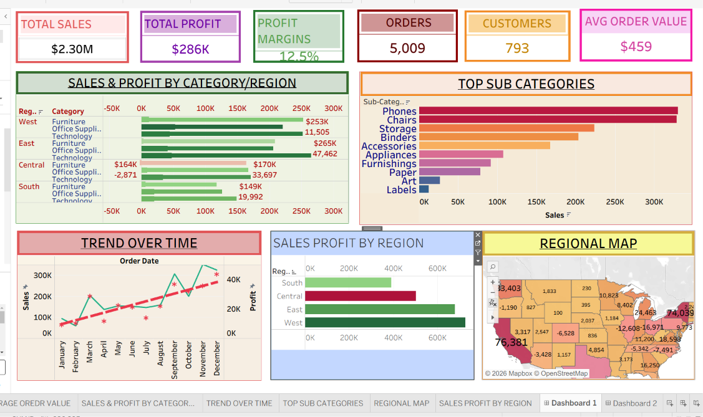

# 📊 Tableau Sales Analytics Dashboard

🔗 **[Click Here to Interact with Live Dashboard on Tableau Public](https://public.tableau.com/views/SalesAnalyticalDashboard_17948563294410/Dashboard1?:language=en-US&:sid=&:redirect=auth&:display_count=n&:origin=viz_share_link)**

## 📌 Project Overview
Interactive Tableau dashboard built to analyze sales performance, uncover regional and category trends, and track key business metrics.

## 🖼️ Dashboard Preview

## 📄 Full Report & Source File
* **[View Dashboard PDF](tab2.pdf)**
* `TAB PROJ .twbx` – Tableau Packaged Workbook (contains workbook and extracted dataset)

## 🛠️ Tools & Techniques Used
* **BI Tool:** Tableau Desktop / Tableau Public
* **Key Features:** Interactive Filters, Calculated Fields, KPI Cards, Trend Visualizations
